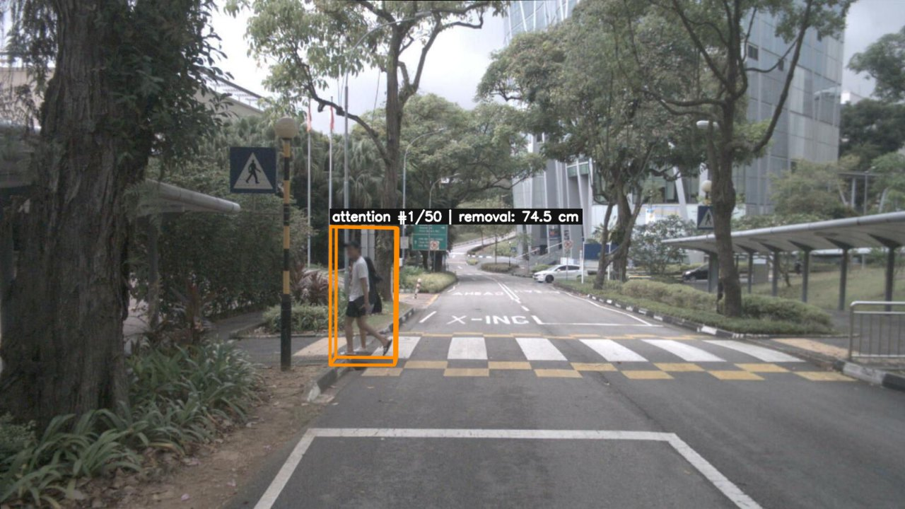
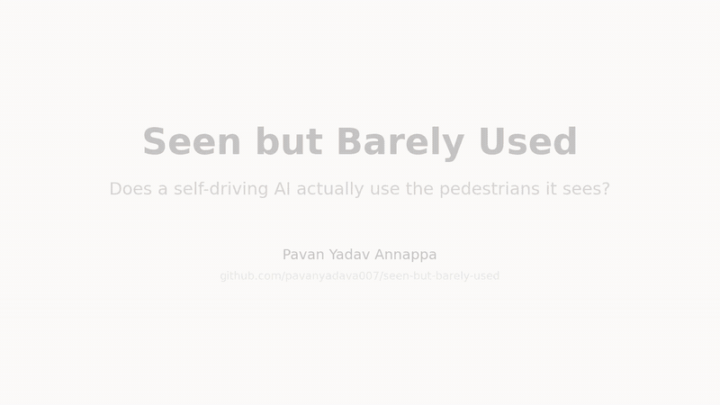
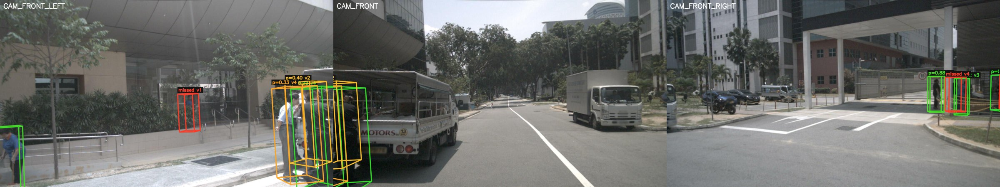
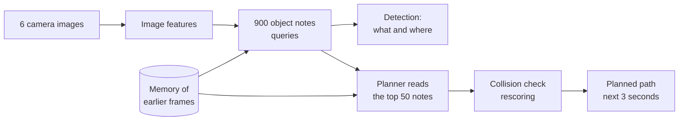
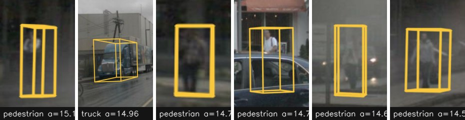
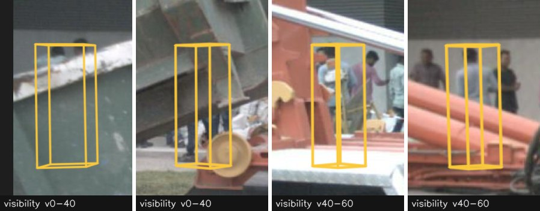
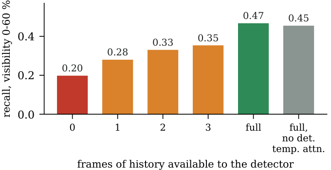
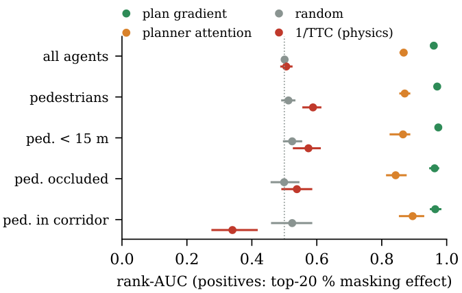

# Seen but Barely Used

### Does a self-driving AI actually *use* the pedestrians it sees?

**Pavan Yadav Annappa** · Friedrich-Alexander-Universität Erlangen-Nürnberg (FAU)

📄 **Paper:** [`paper/paper.pdf`](paper/paper.pdf) · 🧪 **Data:** nuScenes, NAVSIM, Bench2Drive/CARLA (all public) · ⚖️ **Licence:** MIT

<p align="center">
  
  <br><em>The planner's most-attended object in this scene is a pedestrian on a zebra crossing. Removing her from the
  planner's view changes the planned path by 74.5 cm, the largest such effect we found. Most pedestrians change it by
  less than one centimetre.</em>
</p>

---

## 🎬 The whole study in under two minutes

<p align="center">
  
</p>

<p align="center">
  <b><a href="docs/video/explainer.mp4">▶ Watch the full-quality video (MP4, 1 min 48 s)</a></b><br>
  <em>13 short scenes: the problem, how the model works, a real scene, the six findings with their real numbers, and
  the takeaway. Regenerate it with <code>python docs/video/make_video.py</code>.</em>
</p>

---

## Contents

1. [The short version](#1-the-short-version)
2. [Background for newcomers](#2-background-for-newcomers)
3. [What we found](#3-what-we-found)
4. [How we tested it](#4-how-we-tested-it)
5. [Why this matters](#5-why-this-matters)
6. [What is in this repository](#6-what-is-in-this-repository)
7. [Reproducing the results](#7-reproducing-the-results)
8. [Limitations](#8-limitations)
9. [FAQ](#9-faq)
10. [Glossary](#10-glossary)
11. [Citation, licence, acknowledgements](#11-citation)

---

## 1. The short version

Modern self-driving systems increasingly use **one neural network** that goes all the way from camera images to a
planned path. They are judged by driving scores: did the car stay on the road, did it collide, did it make progress.

A good score does **not** tell you *why* the car drove well. In particular it does not tell you whether the system
**sees** pedestrians, **understands** them, and **takes them into account** when it plans.

We opened up one such system, **SparseDrive**, and followed every pedestrian from the camera image to the planned path.
The answer in one sentence:

> **The model sees pedestrians clearly and even understands what they are doing, but its planned path hardly depends
> on them, and neither the driving score nor the model's attention would tell you this.**

| Question | Answer |
|---|---|
| Does the model **see** pedestrians? | **Yes.** "Pedestrian" is a clean, separate signal inside the model; only 1.6 % of detected pedestrians are mistaken for another class. |
| Does it **understand** them? | **Partly yes.** It encodes whether a pedestrian walks towards the car's path, stands on a zebra crossing or is on the road. |
| Where does it **struggle**? | **New and hidden pedestrians.** A pedestrian who has just appeared is detected only 11 % (partly hidden) or 22 % (visible) of the time. |
| Does the plan **use** them? | **Barely.** Removing a pedestrian moves the plan by centimetres, less than removing a comparable car. Removing *all* pedestrians changes the plan about a sixth as much as removing all vehicles, and leaves the NAVSIM driving score unchanged. |
| Does **attention** tell you this? | **No.** The planner attends to the right agents, but attention does not show how much the plan depends on them. Only removing them does. |

---

## 2. Background for newcomers

You do not need a machine-learning background for this section.

### 2.1 What is an "end-to-end" driving model?

Classic self-driving software is a chain of separate programs: one finds objects, one predicts where they will move,
one plans the path. Engineers can inspect each step.

An **end-to-end** model replaces the chain with a single neural network trained on recorded human driving. Six cameras
go in, a planned path for the next three seconds comes out. This often drives better, but the reasoning in the middle
is hidden inside millions of numbers.

### 2.2 How SparseDrive works, in plain words

<p align="center">
  
  <br><em>One scene from the dataset. Each pedestrian is coloured by how confident the model is that it is a
  pedestrian; red means the model missed it.</em>
</p>

Think of SparseDrive as having **900 sticky notes** (the paper calls them *queries*). Each note can attach itself to
one thing in the scene: a car, a pedestrian, a cone, or nothing. For every note the model writes down **what** it is,
**where** it is and **how** it moves, as a list of 256 numbers.



The **planner** reads the 50 most relevant notes, looks at its **memory** of earlier moments, runs a **collision
check** on candidate paths, and outputs the path. Our question is simple: **when a note says "pedestrian", how much
does that change the path?**

### 2.3 The four questions we ask

| | Question | Everyday version |
|---|---|---|
| **RQ1** | Where does pedestrian evidence come from in the image? | *What part of the picture made the model say "pedestrian"?* |
| **RQ2** | How is "pedestrian" stored inside the model? | *Is there a clear "pedestrian" idea, or is it mixed up with other things?* |
| **RQ3** | What happens with hidden (occluded) pedestrians? | *Does the model still find someone half behind a truck?* |
| **RQ4** | Does the planner use pedestrians? | *If we hide a pedestrian from the planner, does the path change?* |
| **RQ5** | Does it hold on other data and in closed loop? | *Same story on a different dataset and in a driving simulator?* |

---

## 3. What we found

All numbers come from the full nuScenes v1.0-trainval split (validation: 6,019 frames in 150 scenes) unless stated.
Brackets are 95 % confidence intervals from a bootstrap over scenes.

### Finding 1: the model sees pedestrians clearly

- Inside the model, "pedestrian" is a **nearly separate direction**, distinct from every other class.
- Only **1.6 %** of the pedestrians the model detects are scored higher as another class.
- A *sparse autoencoder* (a tool that splits the model's numbers into simpler building blocks) finds about
  **20 building blocks** (out of 2,002 in use) that respond specifically to pedestrians.
- These blocks are partly reproducible: retraining the tool with a different random seed gives a similar *group* of
  pedestrian blocks (overlap 0.62, versus 0.31 for random blocks), but not the same individual blocks.
- The blocks are specific: switching off the 10 pedestrian blocks costs **4.9** points of pedestrian detection quality
  (average precision) and 2.0 for cars; switching off 10 car blocks costs **14.5** for cars and 2.1 for pedestrians;
  10 random blocks cost almost nothing.

<p align="center">
  
  <br><em>What one pedestrian building block responds to most strongly: dim or distant pedestrians.</em>
</p>

### Finding 2: it understands useful details, but does not act on them

Using *probes* (small test classifiers that check what information is present), with careful controls for simple
shortcuts such as distance and position, the model encodes **8 of 10** tested properties beyond those shortcuts,
including:

- walking **towards the car's path**,
- standing on a **zebra crossing**,
- being **on the road**,
- being in a **group**, being a **construction worker**, **emerging from behind** an obstacle.

But pedestrians with these properties receive **no more planner attention** than other pedestrians
(for "walking towards the path": difference in attention percentile −0.01 [−0.08, +0.06]).
The knowledge is there; the planner does not single these pedestrians out.

### Finding 3: hidden and newly appearing pedestrians are the weak point

<p align="center">
  
  <br><em>A pedestrian behind construction machinery. In the last frame it is found only because the model remembers
  the previous frames.</em>
</p>

- Hidden pedestrians are found mainly through **memory**. Without memory, detection of partly hidden pedestrians drops
  from 0.47 to 0.20; for visible pedestrians from 0.66 to 0.46.
- A pedestrian who has **just appeared** has no memory yet. At first sighting only **11 %** of partly hidden and
  **22 %** of visible pedestrians are detected, rising to 55 % and 71 % after four or more earlier sightings.
- Being partly hidden also lowers the model's pedestrian confidence, even at the same distance and size.

<p align="center"></p>

### Finding 4 (the headline): the planner barely uses pedestrians

We hid pedestrians from the planner in increasingly complete ways and measured how far the planned path moved.

| What we removed | Path change |
|---|---|
| One pedestrian, from the planner's attention | **0.72 cm** on average (cars: 2.05 cm) |
| One pedestrian vs. one car **matched** on distance, offset from the path and confidence | **1.51 cm vs. 3.72 cm** (difference −2.21 [−2.78, −1.60]) |
| One pedestrian in the car's corridor, from attention **and** the collision check | **3.8 cm** (1,549 pedestrians) |
| **All** detected pedestrians, from attention, collision check **and memory**, in every frame | **5.6 cm** per frame (5.6 pedestrians per frame on average) |
| **All** detected vehicles, the same way | **35.5 cm** per frame (11.9 vehicles per frame) |

For scale: the planner's own average error against the human driver is **61 cm**.

The large effects that do occur are rare **mode switches**: the planner jumps to a different kind of manoeuvre.
35 of 7,555 single-pedestrian removals caused one, with up to 4.4 m of change.

### Finding 5: attention points the right way but does not measure reliance

The planner's attention ranks well which agents matter most (rank-AUC **0.90** [0.86, 0.93] for pedestrians in the car's
corridor; 0.5 would be guessing). A simple physics rule (time to collision) does worse than guessing (0.34).

<p align="center"></p>

So attention tells you **which** agents matter **relative to each other**, but not **how much** the plan depends on
them. A pedestrian can top the attention list and still barely move the path.

### Finding 6: the same on a second dataset; closed loop is a pilot

**NAVSIM** (a different dataset, different cameras; 1,712 scenes from 33 logs, zero-shot):

| Planner input | Driving score (EPDMS) | Change vs. unchanged |
|---|---|---|
| Unchanged | 0.577 | |
| All pedestrians removed (every frame) | 0.578 | **+0.001** [−0.006, +0.007] |
| All vehicles removed (every frame) | 0.554 | **−0.023** [−0.036, −0.009] |
| All agents removed | 0.547 | −0.030 |
| Constant-velocity baseline (no learning) | 0.312 | |

Removing vehicles hurts the score; removing pedestrians does not.

**CARLA / Bench2Drive** (closed-loop simulator, 20 pedestrian routes, 2 repetitions each): the model as released
records 25 pedestrian collisions in 23 of its 40 runs. Two fine-tuned variants collide less, but mainly because they
complete less of each route. This part is a feasibility pilot.

---

## 4. How we tested it

Each method below has a plain-words description and the technical name used in the paper.

| Step | In plain words | Technically |
|---|---|---|
| **Matching** | Link each of the 900 notes to the real pedestrian it describes. | Hungarian matching of queries to annotations within 2 m |
| **Safety groups** | Separate pedestrians that matter for safety (in the car's corridor, close, hidden). | Strata: corridor (8 m / 8 s), distance, visibility |
| **Heat maps** | Which pixels made the model say "pedestrian"? Checked against randomised models. | DFA sampling density, gradients, SmoothGrad, D-RISE; ROAD faithfulness; model randomisation |
| **Probes** | Train a tiny classifier on the 256 numbers: can it read off a property? Compare with a "nonsense" control task. | Linear probes with control tasks, balanced accuracy |
| **Shortcut control** | Is "walking towards the path" really encoded, or just "being in front of the car"? Test what remains after removing the shortcut. | Confound-only and residual probes; LEACE concept erasure |
| **Concept direction** | Does pushing a note towards "pedestrian" raise its pedestrian score? | TCAV, Bonferroni-corrected against random directions |
| **Building blocks** | Split the 256 numbers into many simple, mostly-off building blocks and look at what each responds to. | Top-k sparse autoencoders (own + Overcomplete toolbox), ablation and steering with random controls, seed stability |
| **Hiding from the planner** | Remove a pedestrian from what the planner reads and measure how far the path moves. | Attention-key masking, rescore removal, complete removal incl. memory; ΔL2 of the plan |
| **Memory test** | Run the detector with 0, 1, 2 or 3 frames of history. | Instance-bank truncation, temporal-attention ablation |
| **Statistics** | Make sure results are not due to a few unusual scenes. | Scene-clustered bootstrap (1,000 resamples), matched comparisons |

**Why the planner tests are trustworthy:** the model's perception has a tiny amount of randomness between runs. We run
perception **once**, store the result, and replay the planner on that stored result with and without each
intervention. Unit tests confirm that the re-implemented planner matches the original, that a "do-nothing" intervention leaves
the plan unchanged, and that the replayed baseline reproduces the original plans, so every measured change comes from
the intervention.

---

## 5. Why this matters

- **For safety engineers:** a high driving score is not evidence that a model reacts to pedestrians. Standards for
  automated driving (ISO 21448 / SOTIF, UL 4600) ask for arguments about *why* a system is safe. Removal tests like
  these provide that kind of evidence.
- **For researchers:** this is a reusable, step-by-step protocol to check any query-based driving model, built only
  from public code and data.
- **For practitioners:** it points to concrete places to test: newly appearing and partly hidden pedestrians, and
  whether the planner reacts to what perception already knows.

---

## 6. What is in this repository

```
seen-but-barely-used/
├── sdxai/                     analysis package (added on top of upstream SparseDrive; no upstream file changed)
│   ├── extract.py, hooks.py   read out the model's internal numbers at 7 points
│   ├── replay.py, runner.py   run perception once, replay the planner deterministically
│   ├── planner.py             planner re-implementation with intervention hooks
│   ├── instances.py           match queries to annotated objects; safety strata
│   ├── attribution/           heat maps (DFA, gradient, SmoothGrad, D-RISE) + faithfulness + sanity checks
│   ├── concepts/              class directions, probes, TCAV, sparse autoencoders, fine-grained pedestrian concepts
│   ├── interventions/         hiding agents from the planner (single, group, complete removal), memory tests
│   ├── navsim/                run SparseDrive on NAVSIM and score it with the official EPDMS
│   ├── carla/, b2d/           CARLA agent and Bench2Drive data conversion and map generation
│   ├── metrics.py, stats.py   plan metrics, AP, bootstrap and matching statistics
│   └── report/                generates the full experiment report (report.md)
├── scripts_xai/               phase scripts p0 ... p7 (run in order) + disk guard
├── tests/                     equivalence tests: planner re-implementation = upstream, eager = flash attention, no-op interventions = identity
├── paper/
│   ├── main.tex, references.bib, tables/, figures/
│   ├── build.sh               numbers -> tables -> figures -> PDF
│   ├── build_numbers.py       turns result files into every number and table in the paper
│   ├── review_analyses.py, concept_planner.py, navsim_groups_ci.py, sae_seed_*.py   extra analyses
│   ├── *.json                 small result summaries used by the paper
│   └── paper.pdf              the compiled paper
└── docs/
    ├── img/                   figures and the animated explainer (GIF) for this README
    └── video/                 explainer video (MP4) and make_video.py that builds it from the paper's numbers
```

---

## 7. Reproducing the results

### 7.1 What you need

| | Used for this paper |
|---|---|
| GPU | one NVIDIA GPU with at least 22 GB memory (we used an L4) |
| Disk | about 100 GB free (nuScenes camera keyframes about 41 GB, extracted features and results about 18 GB, plus working space) |
| Software | Python 3.8, PyTorch 1.13.1 (CUDA 11.7), mmcv-full 1.7.1, flash-attention 2.3 |
| Data | [nuScenes v1.0-trainval](https://www.nuscenes.org/) (camera keyframes and annotations); optional: [NAVSIM / OpenScene](https://github.com/autonomousvision/navsim), [Bench2Drive](https://github.com/Thinklab-SJTU/Bench2Drive) + CARLA 0.9.15 |
| Model | the released SparseDrive-S stage-2 checkpoint |

### 7.2 Setup

```bash
# 1. Upstream SparseDrive at the tested commit
git clone https://github.com/swc-17/SparseDrive.git
cd SparseDrive && git checkout fbadea693cbef3f3daea7705e521c0dd3321605c
# install it and download the stage-2 checkpoint as described in its README

# 2. Add this repository's code on top (no upstream file is modified)
git clone https://github.com/pavanyadava007/seen-but-barely-used.git ../sbbu
cp -r ../sbbu/sdxai ../sbbu/scripts_xai ../sbbu/tests .

# 3. Tell the code where things are
export SDXAI_ROOT=/path/to/workspace            # folder that contains SparseDrive/, nuscenes/, navsim_exp/, b2d/
export OPENSCENE_DATA_ROOT=/path/to/openscene   # only for NAVSIM
export SDXAI_VERSION=trainval                   # use "mini" for a quick check on nuScenes-mini
export PYTHONPATH=$PWD
```

### 7.3 Run the phases

Every long phase saves checkpoints and continues where it stopped if interrupted.

| Phase | Command | What it produces |
|---|---|---|
| 0 Baseline | `bash scripts_xai/p0_baseline.sh` | reproduces the published detection, mapping and planning metrics; measures run-to-run noise |
| 1 Extraction | `bash scripts_xai/p1_extract.sh --version trainval` | internal features at 7 read-out points (after equivalence tests) |
| 2 Instances | `bash scripts_xai/p2_instances.sh` | one row per annotated object and per detection, with safety strata |
| 3 Attribution | `bash scripts_xai/p3_attribution.sh` | heat maps, faithfulness and sanity-check tables |
| 4 Concepts | `bash scripts_xai/p4_concepts.sh` | class directions, probes, sparse autoencoders, TCAV |
| 5 Interventions | `bash scripts_xai/p5_interventions.sh` | single-agent removal, rankings, relocation, collision-check ablation |
| 6 Temporal | `bash scripts_xai/p6_temporal.sh` | memory (history-length) tests |
| 7 Report | `bash scripts_xai/p7_report.sh` | fine-grained pedestrian concepts and `work_dirs/xai/report/report.md` |

Additional analyses added for the paper:

```bash
python -m sdxai.interventions.sustained_groups   # complete group removal over every validation frame
python -m sdxai.concepts.sae_controls            # car / random controls and steering baselines for the SAE
python -m sdxai.concepts.sae --sizes 2048 --ks 64 --seed 1 --out work_dirs/xai/concepts/sae_seed1   # extra seeds
```

### 7.4 NAVSIM (optional)

```bash
python -m sdxai.navsim.run_sparsedrive --split navtest --intervention none --out navsim_exp/sd_navtest38_none.pkl
# interventions: none | mask_peds | drop_peds | full_peds | full_vehicles | full_agents
python sdxai/navsim/make_split.py navsim_exp/sd_navtest38_none.pkl sdxai_navtest38_none test
# then score with the official devkit through sdxai.navsim.score (one-stage EPDMS)
```

### 7.5 Rebuild the paper

```bash
cd paper && PYTHON=python bash build.sh     # regenerates numbers.tex, tables, figures and main.pdf
```

---

## 8. Limitations

- **One model.** We study SparseDrive-S only. The protocol applies to other query-based planners, but the findings may
  differ.
- **Mostly open loop.** On nuScenes the car replays recorded driving; interventions change the plan, not the world.
  NAVSIM is a pseudo-simulation; the CARLA part is a pilot without pedestrian removal in closed loop.
- **Confident detections only.** "Complete removal" removes detections with confidence above 0.3; weaker pedestrian
  evidence stays in the model.
- **"Barely used" has no normative reference.** We show the plan depends little on pedestrians; we do not test how much
  it *should* react, for example on frames where the human driver yields.
- **Linear concept tests.** Probes and concept directions detect linearly readable information only.

---

## 9. FAQ

**Does this mean the car will run over pedestrians?**
No. The study measures how much the *planned path* depends on pedestrian information in recorded scenes. A small
dependence is a warning sign worth testing further, not proof of unsafe behaviour. It does show that a good driving
score alone is not enough evidence.

**Why would a model see pedestrians but not use them?**
It learned from recorded human driving. In most recordings the human driver did not need to react to pedestrians, so
the training signal rarely rewards reacting to them. Models can also lean on their own speed and history (the
"ego-status shortcut").

**Why not just look at the attention maps?**
Attention shows what the planner looks at, not how much the decision depends on it. We found attention ranks agents
well but cannot tell a pedestrian that matters a lot from one that barely matters.

**Did you change the model?**
No. We analyse the released checkpoint as it is. All interventions are applied at analysis time.

**Can I run this on a laptop?**
The full study needs a large GPU and the full nuScenes dataset. Setting `SDXAI_VERSION=mini` runs the pipeline on the
small nuScenes-mini split for a quick check.

---

## 10. Glossary

| Term | Meaning |
|---|---|
| **End-to-end model** | One neural network from camera images to planned path. |
| **Query** | One of 900 internal "object notes" (256 numbers each) that SparseDrive uses to represent objects. |
| **Planner** | The part of the model that outputs the path for the next 3 seconds. |
| **Attention** | How strongly the planner looks at each object note. |
| **Rescoring / collision check** | Step that penalises candidate paths predicted to collide with detected agents. |
| **Memory / temporal queue** | Information carried over from earlier frames. |
| **Occlusion** | An object partly hidden behind another (visibility 0-60 %). |
| **Probe** | A small classifier trained to read a property from internal numbers. |
| **Confound** | A simpler explanation for a result (for example distance instead of "walking towards the path"). |
| **TCAV** | Tests whether moving along a concept direction raises a class score. |
| **Sparse autoencoder (SAE)** | Splits internal numbers into many simple building blocks, of which only a few are active at once. |
| **ΔL2** | How far the planned path moves, averaged over 1, 2 and 3 seconds ahead. |
| **Rank-AUC** | How well a ranking puts the most important agents first (1.0 perfect, 0.5 guessing). |
| **EPDMS** | NAVSIM's driving score (0 to 1), combining safety, rule compliance, progress and comfort. |
| **Bootstrap CI** | A range of plausible values, obtained by resampling scenes. |

---

## 11. Citation

```bibtex
@misc{annappa2026seen,
  author = {Pavan Yadav Annappa},
  title  = {Seen but Barely Used: Concept-Level Interpretability of Pedestrian Perception
            in a Sparse End-to-End Driving Model},
  year   = {2026},
  note   = {Code: https://github.com/pavanyadava007/seen-but-barely-used}
}
```

### Licence

The code in this repository is released under the **MIT licence** (see [`LICENSE`](LICENSE)). It builds on
[SparseDrive](https://github.com/swc-17/SparseDrive) (MIT, © 2024 swc-17). Figures contain camera images from
[nuScenes](https://www.nuscenes.org/) (Motional), used under CC BY-NC-SA 4.0.

### Acknowledgements

This work uses the public SparseDrive code and checkpoint, the nuScenes dataset, the NAVSIM devkit and OpenScene data,
Bench2Drive and CARLA, and the Overcomplete dictionary-learning toolbox.
